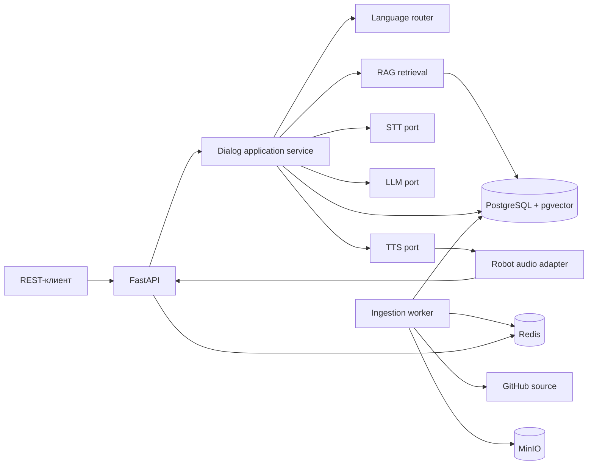

# Архитектура и дорожная карта

Статус: P0 / PROPOSED, 2026-11-11. Факты среды и ограничения перечислены в [backend/README.md](../../README.md). Приоритет источников описан в [source-policy.md](source-policy.md).

## 1. System architecture

API отвечает за транспорт, валидацию и доступ. Application координирует сценарии. Domain содержит правила и порты. Infrastructure реализует порты БД, очереди, моделей и робота. Синхронный inference не выполняется в event loop FastAPI.

## 2. Module responsibility matrix и зависимости

| Модуль | Ответственность | Зависит от портов |
| --- | --- | --- |
| Identity | Операторский доступ и RBAC | UserRepository, TokenService |
| Knowledge | Источники, версии, индексация | SourceFetcher, Parser, Embedder, DocumentRepository, ObjectStore, JobQueue |
| RAG | Поиск, фильтры, релевантность | Embedder, ChunkSearch |
| Language | `kk/ru/en`, голос и фразы отказа | Нет инфраструктурных портов |
| Speech | STT, TTS, валидация аудио | STTEngine, TTSEngine |
| LLM | Вызов локальной модели и проверка ссылок | LLMEngine |
| Dialog | Бюджет времени и порядок операций | RAG, LLM, Speech, SessionRepository, Robot ports |
| Conversations | Сессии, ходы, сроки хранения | SessionRepository |
| Robot | Аудиоввод, вывод, состояние | RobotAudioInputPort, RobotAudioOutputPort, RobotStatePort |
| Media | Исходники и временные объекты | ObjectStore |
| Observability | Логи, метрики, readiness, аудит | Logger, Metrics, AuditRepository |

Граф импортов: `API → Application → Domain`; Infrastructure зависит от интерфейсов Application/Domain и подключается в bootstrap. Между бизнес-модулями разрешены вызовы их публичных application-интерфейсов; ORM и SDK-типы наружу не выдаются.

## 3. Data flow

**Текст:** вопрос → язык → embedding → поиск по активным разрешённым версиям → проверка релевантности → контекст → LLM → проверка `source_ids` → ответ и сохранение хода. Пустой контекст возвращает локализованный отказ без генерации фактов.

**Голос:** аудиоввод → формат/длительность/VAD → STT → проверка языка → текстовый путь → TTS → проверка аудиоформата → вывод на роботе. Каждый шаг получает ограниченный остаток общего timeout budget и поддерживает отмену. Ошибка вывода сохраняет текстовый результат с корректным статусом доставки.

## 4. Data design

PostgreSQL: `knowledge_sources`, `knowledge_documents`, `knowledge_document_versions`, `knowledge_chunks`, `ingestion_jobs`, `dialog_sessions`, `dialog_turns`, `dialog_turn_sources`, `audit_events`. `users` и `robot_devices` создавать по подтверждённым сценариям. Все записи имеют UUID primary key и timestamps UTC; связи используют foreign keys.

- Уникальность `(source_id, source_path)` для документа, `(document_id, source_commit, checksum)` для версии, `(version_id, chunk_index, embedding_model_version)` для фрагмента.
- Фрагмент хранит текст, диапазон страниц, язык, статус, уровень доступа, model version и embedding. Размерность embedding задаётся после выбора модели и проверки памяти.
- Новая версия индексируется отдельно. Переключение `active_version_id` происходит в транзакции после полной проверки. Неизменённый checksum не создаёт дубликаты.
- Индекс pgvector: начать с точного поиска; HNSW рассматривать после измерения качества и задержки. Полнотекстовый поиск PostgreSQL может дополнять векторный после оценки.
- Redis хранит короткоживущее состояние, rate limit, блокировки и координацию worker; постоянные задания и результаты записываются в PostgreSQL.
- MinIO: отдельные приватные buckets исходников и временных артефактов; ключ объекта связан с document/version id, checksum и типом. Для временного аудио TTL и очистка, запись голоса по умолчанию отключена. Шифрование, presigned URL и retention утверждаются до эксплуатации.

## 5. API и OpenAPI

Первые кандидаты: `GET /api/v1/health/live`, `GET /api/v1/health/ready`, `POST /api/v1/dialog/text`, `POST /api/v1/knowledge/ingest`, `GET /api/v1/knowledge/jobs/{job_id}`, `GET /api/v1/knowledge/documents`. Административные knowledge-маршруты требуют авторизации. Публичный dialog ограничивается rate limit. Аудио, история и роботные маршруты добавляются в соответствующих фазах.

`DialogTextRequest`: `question` (непустой, ограничение длины), `language?` (`kk|ru|en`), `session_id?`, `idempotency_key?`. `DialogTextResponse`: `turn_id`, `answer`, `language`, `grounded`, `sources[]`, `status`, `timings`. `Source`: `document_id`, `version_id`, `source_path`, `source_url`, `page_start`, `page_end`. Источники ответа должны реально принадлежать использованному контексту.

Ошибка: `{ "error": { "code": "...", "message": "...", "request_id": "uuid", "details": {} } }`. Коды HTTP выбираются по причине: 401/403 для доступа, 409 для конфликтной идемпотентности, 413 для размера, 422 для входных данных, 429 для лимита, 503 для неготового индекса/модели, 504 для timeout. Документация `/docs`, `/redoc`, `/openapi.json` генерируется из Pydantic схем и тестируется автоматически; отдельной ручной OpenAPI-схемы нет.

## 6. AI architecture

Faster Whisper/CTranslate2: модель и режим вычисления выбираются после замера; результат содержит текст, язык, длительность, время обработки и доступные сигналы качества без вымышленной калиброванной уверенности. BGE-M3 и Qwen2.5-7B-Instruct — кандидаты, не утверждённые модели. Проверка проводится на контрольных вопросах `kk/ru/en` и реальном лимите памяти. Piper: голос для каждого языка, проверка лицензии, произношения и формата вывода. Документный текст передаётся LLM как данные, с явным запретом выполнять найденные в нём инструкции.

`grounded=true` допускается, если источник активен и разрешён, retrieval прошёл порог, а ссылки принадлежат переданным фрагментам. Это техническая проверка ссылок, не доказательство истинности каждого слова; AI evaluation оценивает фактическую корректность отдельно.

## 7. Robotics integration

Сначала mock adapters и контракт портов. Затем обследование конкретного G1 EDU+: модель Jetson, RAM/GPU, ОС/JetPack, SDK2, ROS2, текущие процессы, интерфейсы микрофона и динамика, форматы, сеть и задержка. Пример Saxion `unitree_converse` — кандидат для исследования, а его адреса, топики и протоколы не переносятся без проверки. Решение о ROS2 и расположении сервисов принимается после измерений. Контур движения не затрагивается.

## 8. Deployment и security

Development: API, worker, PostgreSQL/pgvector, Redis, MinIO и модели на машине разработчика, robot mock. Robot integration: только подтверждённый audio adapter на роботе или рядом с ним; backend может быть на отдельной машине. Версии образов закреплены, модели и данные лежат на постоянных томах. CI проверяет lint, typing, unit/integration/contract/evaluation. Release, rollback и runbook готовятся до deployment.

Секреты только через окружение/secret manager; `.env` не коммитится. Загрузка извне ограничивает хосты GitHub, размер, MIME, содержимое и пути; права токена минимальны. Публичный ответ фильтруется по access level документа. Логи не содержат секреты и сырые записи голоса; сроки хранения истории и аудио утверждаются до запуска.

## 9. Risk register

| Риск | Мера | Состояние |
| --- | --- | --- |
| Внутренние PDF в публичном репозитории | Матрица публичности и явное разрешение на озвучивание | BLOCKED |
| Устаревшие нормы и должности | Версии, дата проверки, отказ для неподтверждённого актуального факта | PROPOSED |
| Низкое качество казахского поиска/речи | Отдельный набор вопросов и аудиопримеров | PROPOSED |
| Нехватка памяти для моделей | Замеры и разделение компонентов по узлам | BLOCKED |
| Неизвестный аудиотракт робота | Обследование и тест на устройстве | BLOCKED |
| Prompt injection в документах | Изоляция контекста и негативные тесты | PROPOSED |
| Частичная или повторная индексация | Checksum, ограничения и атомарное переключение версии | PROPOSED |

## 10. Фазы и изменения

Каждая следующая фаза оформляет входные условия, точные файлы, контракты, зависимости, миграции, риск, тесты, критерий приёмки и способ отката до начала кода. P0 не создаёт API или миграции.

| Фаза | Зависимость | Цель и проверка | Основные будущие файлы / откат |
| --- | --- | --- | --- |
| P0 | Исходные PDF | Зафиксировать архитектуру, политику и критерии; ревью документов | `backend/docs/architecture/*`; откат документационного коммита |
| P1 | P0 | FastAPI, DI, config, ошибки, OpenAPI; contract tests | `app/main.py`, `bootstrap/`, `pyproject.toml`; revert кода |
| P2 | P1 | PostgreSQL, Redis, MinIO и Alembic; integration tests | `infrastructure/`, `alembic/`, `compose.yaml`; обратная миграция после анализа данных |
| P3 | P2 | GitHub ingestion, версии и идемпотентность; повторный прогон | `knowledge/`, worker; переключить активную версию назад |
| P4 | P3 | Embeddings, pgvector, RAG; evaluation по трём языкам | `rag/`, миграция вектора; вернуть индекс/модель по версии |
| P5 | P4 | Локальная LLM, grounded policy; тест отказов | `llm/`; вернуть model version |
| P6 | P5 | Faster Whisper и аудиовход; шум/тишина/timeout | `speech/`; выключить аудиомаршрут |
| P7 | P6 | Piper для трёх языков; проверка WAV/PCM | `speech/`; вернуть voice version |
| P8 | P7 | Dialog orchestration, cancellation, history | `dialog/`; выключить голосовой сценарий |
| P9 | P8 + обследование | Adapter G1; тест на устройстве | `robot/`; остановить adapter без изменения штатных функций |
| P10 | P9 | Метрики, безопасность, отказоустойчивость | `ops/`, middleware; возврат конфигурации |
| P11 | P10 | E2E, CI, release и runbook | CI/ops; задокументированный rollback релиза |

## 11. Открытые решения

До P1: минимальные публичные сценарии и политика доступа. До P3: классификация PDF и допустимость публикации внутренних сведений. До P4: тестовый набор и модель embedding. До P9: измерения на роботе. Deployment требует отдельного одобрения.
